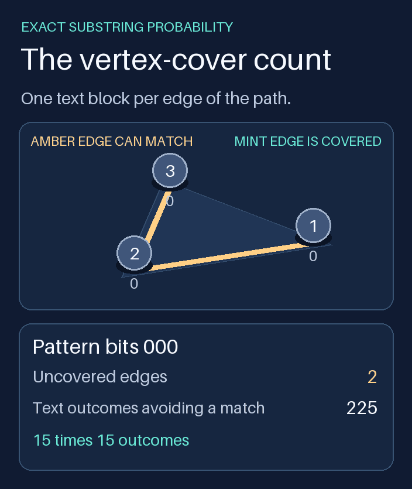

# Exact substring probability for two independent random words

  

Computing the exact chance that one probabilistic word occurs in a second independent word is #P-hard. Binary words with fixed and fair positions suffice. A single exact query recovers a graph's vertex-cover count from the integer number of nonmatches.

[Read the paper](paper/manuscript.pdf) · [LaTeX source](paper/manuscript.tex) · [Proof outline](proof/PROBLEM_AND_PROOF.md) · [Run the replay](REPRODUCIBILITY.md)

## Five vertex covers from a substring probability

The pattern picks a subset of vertices. Each uncovered edge can match in one of 16 text block outcomes; each covered edge rules out its block. The path gives 63 matching outcomes in 2,048 draws. Taking the 1,985 nonmatching outcomes modulo 15 gives the five vertex covers.

[Download the offline explorer](https://raw.githubusercontent.com/DannyExperiments/random-word-substring-probability/refs/tags/v1.0.0/visualization/cover-residue-explorer.zip), extract it, and open `index.html`. Change the pattern bits and the graph edges or rotate the path. [Figure guide](visualization/README.md)

## Exact and approximate computation

The exact result addresses the Shamir-language question. The source's wildcard version asks whether any pattern completion matches a sampled text. For two independent words, the Karp–Luby–Madras method also gives a relative approximation of the occurrence probability and an exact conditional sampler. These use simple products to sample offset matches.

[Original question](https://drops.dagstuhl.de/storage/00lipics/lipics-vol364-stacs2026/LIPIcs.STACS.2026.5/LIPIcs.STACS.2026.5.pdf#page=16) · [Extended version](https://arxiv.org/pdf/2510.08127v2#page=38) · [Pinned Q824](https://github.com/10m-u/open-problems-catalog/blob/ca8d4d44ba3db527f19f28928c240168f545ecfe/problems/mathematics/probability-stochastic-processes-part-1.md#q824)

[Mathematical audit](audits/public_safe_reports/MATHEMATICAL_AUDIT.md) · [Literature audit](audits/public_safe_reports/LITERATURE_AUDIT.md) · [Scope](CLAIM_SCOPE_AND_LIMITATIONS.md) · [AI disclosure](AI_DISCLOSURE.md) · [Status](STATUS.md)

[Release v1.0.0](https://github.com/DannyExperiments/random-word-substring-probability/releases/tag/v1.0.0) · [Version DOI](https://doi.org/10.5281/zenodo.24572575) · [Citation](CITATION.cff)
